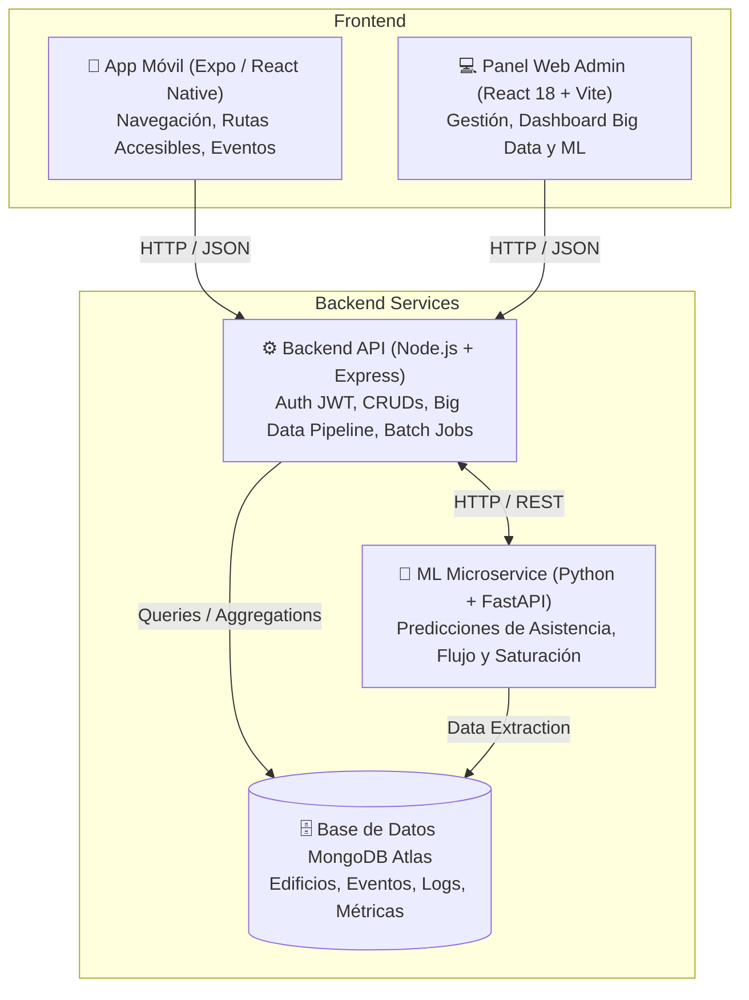

# 📌 Resumen General del Proyecto: INNOVATEC-2025-VZ / SIGMA (Innova2026)

## 📖 1. ¿Qué es el Proyecto?

**INNOVATEC-2025-VZ (SIGMA / Innova2026)** es una plataforma integral de **Campus Inteligente y Gestión de Movilidad Universitaria**. Está diseñada para facilitar la navegación y localización dentro de las instalaciones universitarias, optimizar la difusión de eventos académicos y culturales, y proveer herramientas analíticas y predictivas basadas en **Big Data** e **Inteligencia Artificial (Machine Learning)** para la administración del campus.

---

## 🏛️ 2. Arquitectura del Sistema

El proyecto está estructurado en **cuatro componentes principales interconectados**:

---

## 🧩 3. Componentes y Funcionalidades Principales

### 📱 1. Aplicación Móvil (`/project`)
* **Tecnologías:** Expo Router, React Native 0.79, React Native Maps / Leaflet, Expo Location.
* **Propósito:** Brindar al estudiante y visitante una guía interactiva dentro del campus.
* **Funcionalidades Clave:**
  - 🗺️ **Mapa Interactivo del Campus:** Visualización espacial de edificios, facultades, cubículos, áreas comunes y accesos perimetrales basados en datos GeoJSON.
  - ♿ **Navegación y Rutas Inclusivas:** Motor de grafos (`graphUtils.js`) para calcular la ruta más corta entre puntos, con opción de **rutas accesibles** para personas con movilidad reducida.
  - 📍 **Geolocalización en Tiempo Real:** Detección de perímetro (`isInsideCampus`) y ubicación del usuario (o navegación simulada).
  - 📅 **Exploración de Eventos:** Carrusel y catálogo de eventos universitarios con detalles de horario y ubicación.
  - 🔎 **Buscador Inteligente:** Búsqueda rápida de edificios, carreras y servicios universitarios.

---

### 💻 2. Panel de Administración Web (`/gestory/project`)
* **Tecnologías:** React 18, Vite, React Router, Recharts, SCSS, Lucide Icons (Clean Architecture).
* **Propósito:** Gestión administrativa centralizada y visualización analítica.
* **Funcionalidades Clave:**
  - 🔐 **Autenticación y Seguridad:** Control de acceso exclusivo para administradores con JWT.
  - 🏢 **Gestión de Edificios y Servicios:** Alta, baja, edición y detalle de la infraestructura del campus.
  - 📆 **Gestión y Calendario de Eventos:** Programación, categorización y administración de eventos.
  - 📊 **Dashboard de Big Data:** Gráficos interactivos de actividad de usuarios, zonas más concurridas, popularidad de eventos y análisis temporal.
  - 🤖 **Dashboard de Machine Learning:** Monitoreo del estado del microservicio de IA, ejecución de inferencias, alertas de saturación y métricas de precisión de los modelos.

---

### ⚙️ 3. Backend API (`/backend`)
* **Tecnologías:** Node.js, Express.js, MongoDB / Mongoose, CORS, JWT.
* **Propósito:** Núcleo de servicios RESTful, persistencia y procesamiento de datos.
* **Funcionalidades Clave:**
  - 🛡️ Endpoints REST para autenticación (`/api/auth`), edificios (`/api/buildings`) y eventos (`/api/events`).
  - 📈 **Módulo de Big Data (`/api/bigdata`):** Registro de actividad en tiempo real (`UserActivityLog`), agregaciones de métricas (`BuildingAnalytics`, `EventAnalytics`, `SystemMetrics`).
  - ⏱️ **Procesamiento por Lotes (Batch Jobs):** Trabajos cron/programados para procesar métricas de uso históricas de forma escalable.

---

### 🤖 4. Servicio de Machine Learning (`/backend/ml-service`)
* **Tecnologías:** Python 3.8+, FastAPI, Scikit-learn, Pandas, NumPy, Joblib.
* **Propósito:** Inferencia predictiva para anticipar la afluencia de personas y optimizar la logística del campus.
* **Modelos Implementados:**
  1. 🎟️ **Predicción de Asistencia a Eventos:** Estima la cantidad esperada de asistentes considerando fecha, hora, popularidad y categorías.
  2. 🚶 **Predicción de Demanda de Movilidad:** Proyecta la afluencia de visitantes hacia edificios específicos según el momento del día y la semana.
  3. ⚠️ **Predicción de Nivel de Saturación:** Clasifica el riesgo de congestión de espacios en cuatro categorías (*Baja, Normal, Media, Alta*).
  4. 🔄 **Re-entrenamiento Automático:** Scripts para extraer datos frescos desde MongoDB y actualizar los pesos de los modelos (`train_all_models.py`).

---

## 🛠️ 4. Scripts y Orquestación

El proyecto cuenta con utilidades para facilitar la ejecución y verificación de salud de los servicios:
- 🚀 `start-all-services.ps1`: Script de PowerShell que levanta en paralelo el Backend (puerto 5000), el Panel Web (puerto 5173), la App Expo y el Servicio ML (puerto 8000).
- 🛑 `stop-all-services.ps1`: Detiene todos los procesos y libera los puertos ocupados.
- 🧪 `test-integridad.ps1`: Valida la conectividad entre todos los módulos y la base de datos.
- 🐳 `docker-compose.yml`: Configuración para despliegue contenerizado.

---

## 🎯 5. Valor Diferencial e Impacto

| Aspecto | Beneficio |
| :--- | :--- |
| **Inclusividad y Accesibilidad** | Rutas especialmente adaptadas para personas con movilidad reducida dentro del campus. |
| **Toma de Decisiones Basada en Datos** | Métricas de uso y Big Data para optimización de recursos y eventos. |
| **Prevención y Logística Inteligente** | Anticipación de saturaciones y planificación de aforo mediante Machine Learning. |
| **Experiencia de Usuario Moderna** | App nativa intuitiva complementada con un panel web administrativo en tiempo real. |
